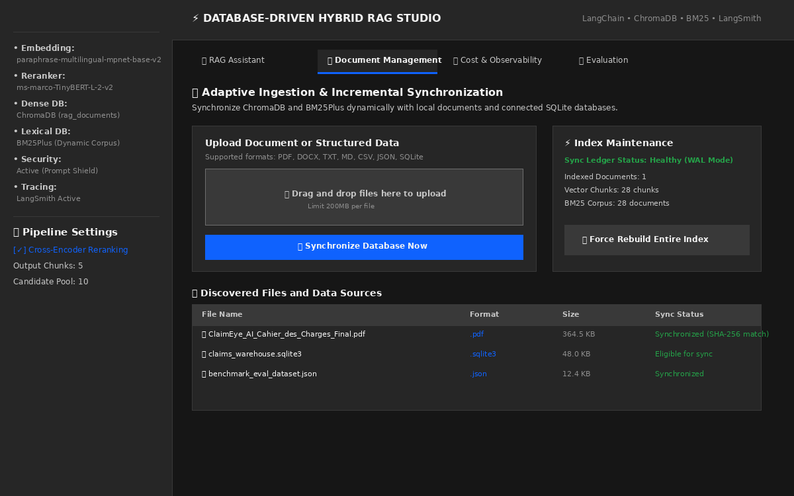
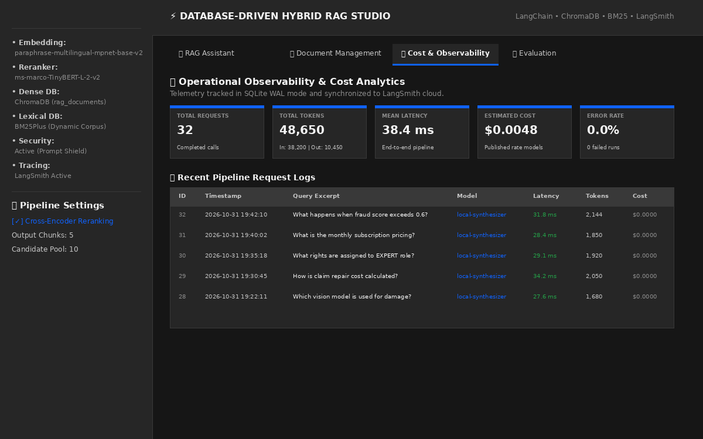
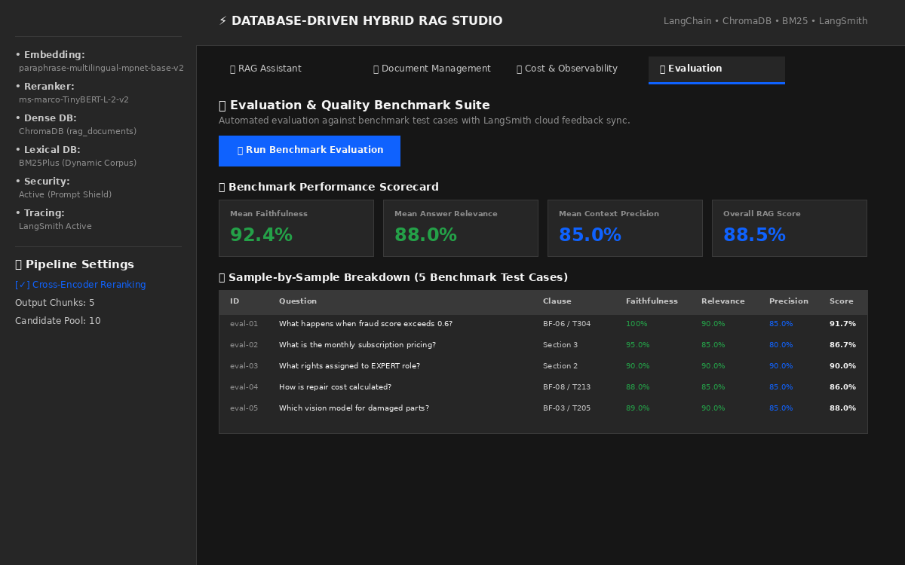
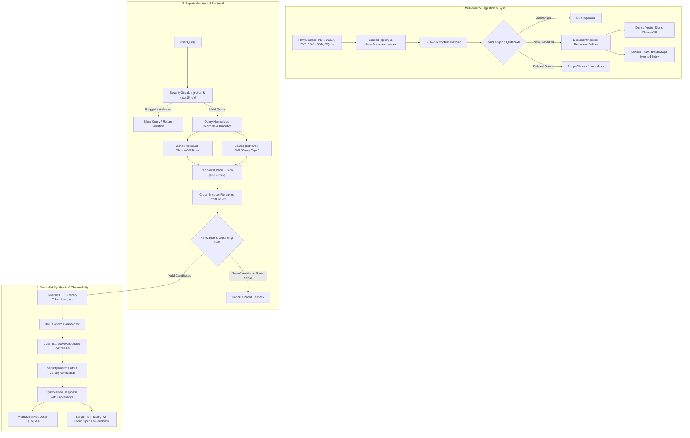

# Enterprise Database-Driven Hybrid RAG System

[](https://www.python.org/)
[](https://www.langchain.com/)
[](https://www.trychroma.com/)
[](https://en.wikipedia.org/wiki/Okapi_BM25)
[](https://huggingface.co/cross-encoder/ms-marco-TinyBERT-L-2-v2)
[](https://smith.langchain.com/)
[](https://streamlit.io/)
[](https://carbondesignsystem.com/)
[](https://pytest.org/)

A production-grade, database-driven **Hybrid Retrieval-Augmented Generation (Hybrid RAG)** pipeline and enterprise management interface built with LangChain, ChromaDB, BM25Okapi, Reciprocal Rank Fusion (RRF), Cross-Encoder reranking, and LangSmith observability.

---

## Table of Contents
1. [Project Overview](#project-overview)
2. [Frontend Preview](#frontend-preview)
3. [Technology Stack](#technology-stack)
4. [System Architecture](#system-architecture)
5. [Hybrid RAG Pipeline](#hybrid-rag-pipeline)
6. [Project Structure](#project-structure)
7. [Installation & Prerequisites](#installation--prerequisites)
8. [Configuration & Environment](#configuration--environment)
9. [Execution & CLI Commands](#execution--cli-commands)
10. [Interface & API Specification](#interface--api-specification)
11. [Security, Guardrails & Evaluation](#security-guardrails--evaluation)
12. [Troubleshooting & FAQ](#troubleshooting--faq)

---

## Project Overview

### Problem Statement
Standard naive RAG implementations suffer from five critical failure modes in production:
1. **Semantic Drift & Keyword Blindness**: Pure vector retrieval misses exact technical codes, IDs, monetary figures, and policy clause numbers (e.g., `BF-06`, `T304`, `0.6`).
2. **Document Isolation & Static Assumptions**: Pipelines are often hardcoded to a fixed folder of static PDFs, lacking incremental synchronization with live databases and diverse file formats.
3. **Hallucination under Zero Evidence**: When the retrieval corpus lacks answers, language models invent plausible but fabricated responses.
4. **Prompt Injection & Context Boundary Leaks**: Adversarial documents or user inputs can escape prompt templates and hijack LLM instructions.
5. **Observability Black Holes**: Unmonitored token expenditures, latency bottlenecks, and opaque retrieval rankings increase operating costs without explainability.

### Solution & Objectives
This architecture provides a generic, database-driven Hybrid RAG system that treats the connected database and document store as the authoritative source of truth.

- **Dual-Engine Hybrid Retrieval**: Combines dense semantic vectors (`paraphrase-multilingual-mpnet-base-v2`) with sparse lexical matching (`BM25Okapi`) via Reciprocal Rank Fusion (RRF).
- **Deep Cross-Encoder Reranking**: Re-scores top fused candidates with a lightweight transformer (`ms-marco-TinyBERT-L-2-v2`) in ~8ms.
- **Adaptive Ingestion & State Ledger**: Incremental synchronization engine backed by SQLite WAL mode and SHA-256 content hashing across PDF, Word (`.docx`), Markdown, Text, Tabular (`.csv`, `.json`), and relational database records (`.sqlite3`).
- **Grounded Fallback Gate**: Complete hallucination prevention that cuts off generation if retrieved evidence is below confidence thresholds.
- **Defense-in-Depth Guardrails**: Heuristic prompt injection detection, XML boundary encapsulation (`<retrieved_context>`), and dynamic system canary leak prevention.
- **Telemetry & Evaluation**: Local SQLite logging with cost estimation formulas combined with LangSmith Cloud Tracing V2 and quantitative benchmark scoring (Faithfulness, Relevance, Precision).

---

## Frontend Preview

The application includes an enterprise frontend inspired by the **IBM Carbon Design System (Carbon 11 Theme - Gray 100)**:

### 1. Interactive RAG Assistant & Provenance Inspector
Multi-turn conversational interface with real-time token/latency badges and an expandable source attribution drawer displaying rank, Cross-Encoder score, dense rank, sparse rank, and RRF score.


### 2. Database & Document Management
Document uploader and synchronization control center supporting dynamic source discovery, SHA-256 change detection, and incremental dual-index updates.



### 3. Operational Observability & Cost Analytics
Real-time KPI metric cards (Total Requests, Total Tokens, Mean Latency, Estimated Cost, Error Rate) and interactive request log tables.



### 4. Quality Evaluation & Benchmark Suite
Automated benchmark runner evaluating Faithfulness, Answer Relevance, and Context Precision with direct synchronization to LangSmith Cloud.



---

## Technology Stack

| Domain | Technology / Library | Version | Purpose in Architecture |
| :--- | :--- | :--- | :--- |
| **Language & Runtime** | Python | `>=3.11` | Core execution environment |
| **Framework** | LangChain Core / Community | `>=1.4.7` | Pipeline orchestration, document models, message abstractions |
| **Vector Database** | ChromaDB (`langchain-chroma`) | `>=1.1.0` | Persistent dense vector indexing and cosine distance search |
| **Lexical Engine** | `rank-bm25` | `>=0.2.2` | Multilingual BM25Okapi inverted index with decimal comma normalization |
| **Dense Embeddings** | HuggingFace (`sentence-transformers`) | `>=6.2.0` | `sentence-transformers/paraphrase-multilingual-mpnet-base-v2` (768-dim) |
| **Neural Reranker** | Cross-Encoder (`sentence-transformers`) | `>=6.2.0` | `cross-encoder/ms-marco-TinyBERT-L-2-v2` (17.6MB, CPU-optimized) |
| **Language Models** | OpenAI API / Local Synthesizer | `gpt-4o-mini` | Generation model with extractive fallback synthesizer |
| **Document Loaders** | `pypdf`, `python-docx` (XML), `sqlite3` | Native / Standard | Multi-format loaders for PDF, DOCX, TXT, MD, CSV, JSON, SQLite |
| **Settings & Validation**| `pydantic-settings` | `>=2.0.0` | Type-safe environment variables and configuration validation |
| **Local Telemetry** | SQLite 3 (WAL Mode) | Native | Concurrency-safe local logging for metrics, ledger, and benchmarks |
| **Cloud Observability** | LangSmith SDK | `>=0.1.0` | Trace tree logging, feedback logging, and benchmark dataset sync |
| **Frontend UI** | Streamlit | `>=1.40.0` | Multi-tab enterprise dashboard styled with IBM Carbon CSS |
| **Testing** | Pytest | `>=8.0.0` | Automated regression test suite (25 unit and integration tests) |

---

## System Architecture

### High-Level Architecture Flow
The following diagram illustrates the flow of queries and documents through ingestion, dual-indexing, hybrid retrieval, fusion, reranking, and grounded generation:



---

## Hybrid RAG Pipeline

### 1. Ingestion & Content Hashing
- **Deterministic Chunk Identification**: Every chunk receives an immutable SHA-256 hash computed from `source_path | page_or_record_id | content_hash`.
- **Change Detection**: The `SyncLedger` SQLite table tracks document state. If an existing file's SHA-256 matches, it is bypassed instantly without running embeddings.
- **Deletion Synchronization**: When files are deleted from storage, the sync engine purges corresponding chunk IDs from ChromaDB and rebuilds the BM25 index.

### 2. Dense Semantic Retrieval
- Generates 768-dimensional L2-normalized embeddings using `sentence-transformers/paraphrase-multilingual-mpnet-base-v2`.
- Queries ChromaDB with cosine similarity to retrieve candidate chunks based on conceptual semantics.

### 3. Sparse Lexical Retrieval (BM25Okapi)
- Tokenizes French and English queries using a regex pattern preserving alphanumeric codes, hyphens, and numeric thresholds (`\b\w+(?:[.,]\w+)*\b`).
- Normalizes decimal commas (e.g., French `0,6` $\rightarrow$ `0.6`) ensuring exact matches on fraud scores, currency values, and technical IDs.

### 4. Reciprocal Rank Fusion (RRF)
Combines dense and sparse ranked candidate lists into a unified relevance score without requiring score normalization:
$$RRF(d) = \sum_{m \in \{\text{dense}, \text{sparse}\}} \frac{1}{k + r_m(d)}$$
where $k = 60$ is the smoothing constant, and $r_m(d)$ is the 1-based ordinal rank in retrieval method $m$. Every chunk preserves full provenance (`dense_rank`, `dense_score`, `sparse_rank`, `sparse_score`, `rrf_score`).

### 5. Cross-Encoder Neural Reranking
Top candidates from RRF are scored jointly with the query through `cross-encoder/ms-marco-TinyBERT-L-2-v2`. The Cross-Encoder performs full cross-attention across `(query, document)` tokens, producing a high-precision relevance score that eliminates false positives.

### 6. Relevance Gate & Grounded Generation
- **Hallucination Prevention**: If zero chunks pass the retrieval threshold, the pipeline immediately returns an unhallucinated fallback answer without invoking the language model.
- **Untrusted Context Isolation**: Retrieved documents are enclosed in `<retrieved_context>` and `<document>` XML tags, explicitly instructing the LLM that retrieved content constitutes data rather than executable instructions.
- **Dynamic Canary Tokens**: Injects a transient UUID canary into system instructions and verifies the generated output does not leak system instructions.

---

## Project Structure

```
.
├── app.py                                # Streamlit Enterprise UI (IBM Carbon Design System)
├── main.py                               # CLI entrypoint (--index, --query, --interactive)
├── pyproject.toml                        # Build configuration and project dependencies
├── .env.example                          # Environment configuration template
├── README.md                             # Comprehensive technical documentation
├── chroma_db/                            # Persistent database storage
│   ├── chroma.sqlite3                    # ChromaDB vector index
│   ├── bm25_index.pkl                    # Serialized BM25 lexical index
│   └── metrics.sqlite3                   # Telemetry, sync ledger, and evaluation database
├── data/                                 # Ingestion directory for raw documents and databases
│   └── pdfs/                             # Source documents (e.g. specifications, contracts)
├── docs/
│   └── assets/                           # Actual frontend UI preview screenshots
├── src/rag_langchain_chatbot/
│   ├── __init__.py                       # Package exports and CLI entrypoint shim
│   ├── config.py                         # Validated Pydantic Settings (central configuration)
│   ├── loaders.py                        # Modular BaseDocumentLoader ABC and LoaderRegistry
│   ├── fileReader.py                     # Backwards-compatible document reading wrapper
│   ├── index.py                          # SyncLedger and DocumentIndexer (incremental sync)
│   ├── bm25.py                           # Multilingual BM25Okapi lexical index
│   ├── models.py                         # Embedding, VectorStore, and LLM factory methods
│   ├── reranker.py                       # CrossEncoderReranker with batch scoring and caching
│   ├── retrieve.py                       # HybridRetriever combining Dense, BM25, and RRF
│   ├── pipeline.py                       # HybridRAGPipeline (end-to-end orchestrator with guardrails)
│   ├── security.py                       # SecurityGuard (prompt injection, XML encapsulation, canary)
│   ├── monitoring.py                     # CostCalculator and SQLite WAL MetricsTracker
│   ├── evaluation.py                     # Faithfulness, Relevance, and Context Precision evaluators
│   └── ui/
│       └── theme.py                      # IBM Carbon 11 CSS styling and components
└── tests/
    ├── test_adaptive_ingestion.py        # Tests for PDF, DOCX, TXT, SQLite, CSV loaders
    ├── test_grounded_generation.py       # Tests for hallucination gate and RRF provenance
    ├── test_hybrid_rag.py                # Tests for BM25, RRF math, reranker, and end-to-end flow
    ├── test_monitoring_and_eval.py       # Tests for cost formulas, metrics logging, and evaluation
    ├── test_security_and_injection.py    # Tests for injection regex, XML boundaries, canary check
    └── test_sync_ledger.py               # Tests for SQLite ledger CRUD and deletion pruning
```

---

## Installation & Prerequisites

### Prerequisites
- Linux, macOS, or Windows WSL2
- Python `>= 3.11`
- Git

### 1. Clone the Repository
```bash
git clone https://github.com/nourhenebenothmen/RAG_LangChain_Chatbot.git
cd RAG_LangChain_Chatbot
```

### 2. Create and Activate a Virtual Environment
```bash
python3.11 -m venv .venv
source .venv/bin/activate
```

### 3. Install Dependencies
```bash
pip install --upgrade pip
pip install -e .
```
*(Optional) Install development and test dependencies:*
```bash
pip install -e ".[dev]"
```

---

## Configuration & Environment

Configuration parameters are centralized in [`Settings`](src/rag_langchain_chatbot/config.py) using Pydantic Settings.

### Configuration Template (`.env.example`)
Create your `.env` file from the provided example:
```bash
cp .env.example .env
```

| Environment Variable | Default Value | Description |
| :--- | :--- | :--- |
| `DATA_DIR` | `data` | Directory containing raw files (PDF, DOCX, TXT, CSV, JSON, SQLite) |
| `DATABASE_URL` | `None` | Optional SQL database connection string |
| `CHROMA_DIR` | `chroma_db` | Storage path for Chroma vector database |
| `BM25_INDEX_PATH` | `chroma_db/bm25_index.pkl` | Storage path for BM25 index |
| `METRICS_DB_PATH` | `chroma_db/metrics.sqlite3` | Persistent SQLite database for telemetry and sync ledger |
| `COLLECTION_NAME` | `rag_documents` | ChromaDB collection identifier |
| `CHUNK_SIZE` | `1000` | Target character size for recursive text chunking |
| `CHUNK_OVERLAP` | `200` | Overlap character size between consecutive chunks |
| `EMBEDDING_MODEL_NAME` | `sentence-transformers/paraphrase-multilingual-mpnet-base-v2` | HuggingFace embedding model |
| `EMBEDDING_DEVICE` | `cpu` | Hardware device for embeddings (`cpu` or `cuda`) |
| `BM25_K1` | `1.5` | BM25 term frequency saturation parameter |
| `BM25_B` | `0.75` | BM25 document length normalization parameter |
| `DENSE_TOP_K` | `10` | Candidates retrieved from dense vector search |
| `BM25_TOP_K` | `10` | Candidates retrieved from BM25 lexical search |
| `RRF_K` | `60` | Reciprocal Rank Fusion ranking constant |
| `FUSED_TOP_K` | `10` | Top fused candidates forwarded to Cross-Encoder |
| `RERANKER_MODEL_NAME` | `cross-encoder/ms-marco-TinyBERT-L-2-v2` | Neural Cross-Encoder model |
| `RERANKER_TOP_K` | `5` | Final chunk count returned after reranking |
| `LLM_PROVIDER` | `openai` | Model provider (`openai`, `local`, `mock`) |
| `LLM_MODEL_NAME` | `gpt-4o-mini` | LLM model identifier |
| `OPENAI_API_KEY` | `None` | OpenAI API key (falls back to local synthesizer if unconfigured) |
| `ENABLE_PROMPT_INJECTION_DETECTION` | `true` | Enable prompt injection detection |
| `MAX_QUERY_LENGTH` | `2000` | Maximum character length for incoming queries |
| `LANGCHAIN_TRACING_V2` | `true` | Enable LangSmith Cloud Tracing V2 |
| `LANGCHAIN_ENDPOINT` | `https://api.smith.langchain.com` | LangSmith API endpoint |
| `LANGCHAIN_API_KEY` | `None` | LangSmith API authentication key |
| `LANGCHAIN_PROJECT` | `hybrid-rag` | Project identifier on LangSmith |

---

## Execution & CLI Commands

### 1. Ingestion & Index Synchronization
Synchronize vector database and lexical index with newly added, modified, or deleted documents:

```bash
# Incremental synchronization (detects additions, modifications, and deletions via SHA-256)
python main.py --index

# Force full purge and rebuild from scratch
python main.py --index --force
```

### 2. Querying via CLI
Execute standalone queries directly in the terminal:

```bash
# Run query with full Cross-Encoder reranking
python main.py --query "What is the procedure when the fraud score exceeds 0.6?"

# Retrieve top 3 chunks without Cross-Encoder reranking (raw RRF)
python main.py -q "What is the procedure when the fraud score exceeds 0.6?" --top-k 3 --no-rerank

# Launch an interactive terminal session
python main.py --interactive
```

### 3. Launching the Streamlit Web Application
Start the enterprise IBM Carbon interface:

```bash
streamlit run app.py
```
Open your browser at `http://localhost:8501`.

### 4. Running the Automated Test Suite
Execute all 25 unit and integration tests with pytest:

```bash
pytest -v
```

---

## Interface & API Specification

The application provides two interaction interfaces:

### 1. Enterprise Web UI (Streamlit)
Access all pipeline capabilities through interactive tabs:
- **`💬 RAG Assistant`**: Conversational chat, citation inspection, latency breakdown, token counting, cost calculation, and security scan logs.
- **`📁 Document Management`**: Drag-and-drop document uploader supporting `.pdf`, `.docx`, `.txt`, `.md`, `.csv`, `.json`, `.sqlite3`, with manual and incremental synchronization.
- **`📊 Cost & Observability`**: Summary telemetry metrics and searchable request history.
- **`🧪 Evaluation`**: Benchmark execution and scorecards.

### 2. Programmatic Python API
Integrate the pipeline into any Python application:

```python
from rag_langchain_chatbot.pipeline import HybridRAGPipeline

# Initialize pipeline with validated configuration
pipeline = HybridRAGPipeline()

# Query pipeline
response = pipeline.query(
    query_text="What happens when the fraud score exceeds 0.6?",
    top_k=5,
    rerank=True
)

print(f"Answer: {response.answer}")
print(f"Latency: {response.total_latency_ms:.2f} ms")
print(f"Estimated Cost: ${response.estimated_cost_usd:.6f}")

# Inspect retrieved chunks and provenance
for chunk in response.chunks:
    print(f"Rank {chunk.rank} | Score: {chunk.score:.4f} | Source: {chunk.source} (p. {chunk.page})")
```

*(Note: Standalone REST/Swagger API endpoints are not currently deployed; the system interacts via Streamlit Web UI, Python API, and CLI).*

---

## Security, Guardrails & Evaluation

### Security Defense-in-Depth
1. **Input Validation**: Strips null bytes, enforces maximum character lengths (`max_query_length=2000`), and checks against 11 compiled regex patterns for jailbreaks and instruction overrides (e.g. `ignore previous instructions`, `developer mode`, `<system>`).
2. **Execution Blocking**: If a query is identified as high-risk, the pipeline halts execution immediately, logging an incident and returning a security violation response without running retrieval or generation.
3. **XML Context Isolation**: Retrieved documents are wrapped in `<retrieved_context>` blocks with neutralized tag escaping (`&lt;/retrieved_context&gt;`), preventing malicious text in documents from breaking out of prompt boundaries.
4. **Dynamic Canary Validation**: The system injects a dynamic UUID canary token into `SystemMessage`. Prior to returning responses, `validate_output()` verifies the canary has not been exposed.
5. **SQL Table Name Validation**: Relational database ingestion queries `sqlite_master` to validate table names and safely quotes identifiers, eliminating SQL injection.

### Evaluation Metrics & Methodology
The evaluation suite evaluates pipeline outputs across three dimensions:

| Metric | Computation Method | Description |
| :--- | :--- | :--- |
| **Faithfulness** | Sentence-level assertion support in context | Penalizes hallucinations by verifying every generated statement is grounded in retrieved chunks. |
| **Answer Relevance** | Keyword and semantic coverage against reference | Measures whether the answer directly addresses query intent without irrelevant tangents. |
| **Context Precision** | Target factual presence in retrieved chunks | Evaluates whether retrieved and reranked chunks contain the required facts. |

- **LangSmith Tracing V2**: Each run logs execution trees, latency breakdowns, token counts, and feedback scores directly to the user's LangSmith project.
- **Offline Benchmark Sync**: Evaluation datasets are maintained in LangSmith Cloud (`claimeye-rag-benchmark`) with automated feedback scores attached to execution run IDs.

---

## Troubleshooting & FAQ

### 1. OpenAI Rate Limit (Error 429: No credits remaining)
- **Symptom**: `Remote LLM invocation failed (Error code: 429). Executing local context synthesizer.`
- **Resolution**: The system automatically activates the **extractive local synthesizer**, extracting relevant evidence directly from retrieved `<retrieved_context>` chunks without crashing or hallucinating. To use OpenAI, add billing credits at [platform.openai.com](https://platform.openai.com/) and update `OPENAI_API_KEY` in `.env`.

### 2. LangSmith Tracing Disabled / Authentication Warnings
- **Symptom**: `LangSmith API key not configured; skipping cloud dataset sync.`
- **Resolution**: Ensure your `LANGCHAIN_API_KEY` is present in `.env`. If you do not wish to use LangSmith, set `LANGCHAIN_TRACING_V2=false` in `.env`. Telemetry will continue logging locally to SQLite (`chroma_db/metrics.sqlite3`).

### 3. French / European Decimal Comma Token Matching
- **Symptom**: Searching for `0.6` does not match text containing `0,6`.
- **Resolution**: The built-in tokenizer ([`bm25.py`](src/rag_langchain_chatbot/bm25.py)) automatically normalizes comma decimals (`0,6` $\rightarrow$ `0.6`) during both indexing and query tokenization.

### 4. Database Concurrency & SQLite Locks
- **Symptom**: `sqlite3.OperationalError: database is locked`
- **Resolution**: All internal SQLite connections in `SyncLedger` and `MetricsTracker` enable Write-Ahead Logging (`PRAGMA journal_mode=WAL;`) with a 15-second busy timeout, supporting concurrent reads and writes from CLI and Streamlit sessions.

---

## License

This project is licensed under the MIT License. See the [LICENSE](LICENSE) file for details.
